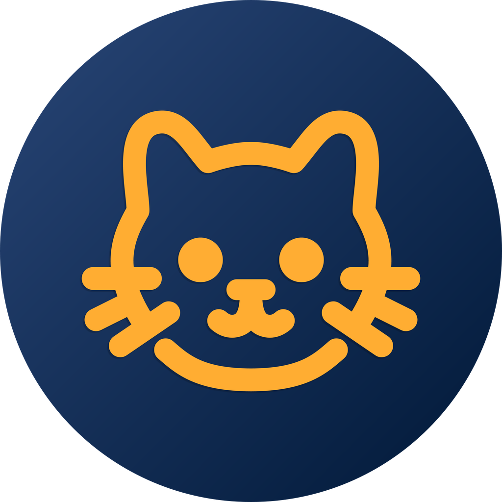
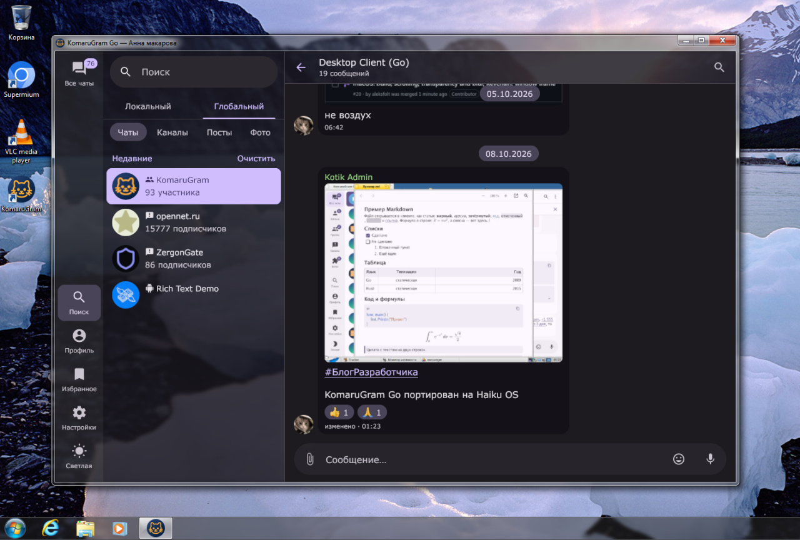

<div align="center">


# KomaruGram Go

Telegram Desktop client in Go. Feature-rich and security-enhanced foundation. Easy to build and freely distributable, using a permissive license.

[English] | [Русский](README_RU.md) | [Other stuff](./docs/README_FULL.md) | [UI Components](./docs/UI_COMPONENTS.md) | [FAQ](./docs/FAQ_EN.md)


<p>Screenshot of KomaruGram Go, built and run on Windows 7</p>

</div>

## What's inside?

Supports multi-account usage, hardware and software data encryption, local (offline) caching, animated stickers, emoji sets, in-chat GIF playback, voice message playback/recording, a media viewer, forums, Instant View, Markdown, Rich Messages, and Mini Apps.

WIP: message formatting and scheduled posting tools, chat and channel administration, user stories, gift sending, Telegram Stars, Gram Wallet, folder/cache/notification settings and plugin system.

[Gio](https://gioui.org/) handles the UI. It is a cross-platform, immediate-mode GUI library. It was chosen because it eliminates the typical limitations of frameworks, has no dependencies, doesn't break cross-platform builds, is fully compatible with Wayland, and can be ported to other platforms without any issues.

[gotd/td](https://github.com/gotd/td) implements MTProto and a little more, which serves as the foundation for all interactions with the Telegram protocol.

[wazero](https://github.com/wazero/wazero) is used as a high-performance WebAssembly sandbox for rendering stickers. It ensures cross-platform portability and guarantees code isolation without launching a separate process.

[dr_libs](https://github.com/mackron/dr_libs), [libopus](https://github.com/xiph/opus) and [Fraunhofer FDK AAC](https://github.com/komarugif/fdk-aac-wasm) are used so that your audio files and voice messages can play directly within the app, without an external player. They are all compiled into WebAssembly modules, dr_libs and libopus are embedded in the application.

FFmpeg, mpv, VLC and Chromium/Firefox are available as external integrations that you must provide yourself. However, the application will work even without them.

Without FFmpeg, or when chosen in the settings, GIFs and animated avatars play with FFmpeg's H.264 and MPEG-4 Part 2 decoders compiled to WebAssembly. They are not built into the application: they are downloaded the first time they are needed from [libavcodec-wasm](https://github.com/komarugif/libavcodec-wasm), which holds their sources and build script. You can use your own build instead: see [Environment variables](./docs/ENVIRONMENT_VARIABLES.md).

## How to get started

Make a copy of this repository. Ensure that **[Go 1.27.3](https://go.dev/dl/)** is installed on your machine — it is the minimum required version: it fixes the checking of certificates in `crypto/x509`, which a man-in-the-middle attack exploits. [Windows 7](./docs/BUILD_WINDOWS7.md) and [Haiku](./docs/BUILD_HAIKU.md) require their own patched versions of Go.

On Linux, Wayland and X11 development libraries may be required: `vulkan-headers mesa-egl mesa-dev libxkbcommon-dev wayland-dev`. Depending on your graphics environment, you can disable specific dependencies using build tags: `-tags nox11`, `-tags nowayland`, or `-tags novulkan`.

The build process may require up to 4.5 GB of RAM; please keep this in mind and close unnecessary applications during the initial build. If you run out of memory, use the environment variables `GOMAXPROCS=1 GOGC=50 GOMEMLIMIT=2GiB`. As a last resort, you can use the `-low-memory` flag with the `./cmd/*-build` scripts; this can cut memory usage during the build in half, at the cost of potential runtime performance loss. [Read more here](./docs/BUILD_LOW_MEMORY.md).

You can use this command to run the application across different platforms:
```
go run ./cmd/messenger
```

If you need to create an executable file, choose the command for your platform:
### **Linux/macOS**
```
go build -ldflags="-s -w" -o komarugram ./cmd/messenger
```
### **Linux** (AppImage with icon)
```
go run ./cmd/appimage-build -o KomaruGram.AppImage
```
### **Windows** (cross-compilation supported)
For your architecture:
```
go run ./cmd/windows-build -o komarugram.exe
```
To select a different architecture:
```
go run ./cmd/windows-build -arch arm64 -o komarugram.exe
```
### **Windows 10/11** (MSIX package)
```
go run ./cmd/msix-build -o KomaruGram.msix
```
### **Haiku**
```
go run ./cmd/haiku-build -o ~/apps/KomaruGram
```

## Portability

KomaruGram Go can be ported to a wide range of operating systems thanks to its architecture and minimal dependencies. Check out [PLATFORMS.md](./docs/PLATFORMS.md) if you are interested in platform-specific details.

| Platform | Status |
|---|---|
| Windows 10/11 | ✅ First-class support |
| Windows 7 | ✅ Supported |
| Linux (Wayland) | ✅ First-class support |
| Linux (X11) | ✅ Supported |
| MacOS | ✅ First-class support |
| Haiku | ✅ Supported |
| FreeBSD | ⚠️ Should build; not tested in practice |
| OpenBSD | ⚠️ Should build in theory; not tested |
| NetBSD | ❓ Porting possible, with some caveats |
| Android | ❓ Porting possible, with some caveats |

## Thanks

We thank the creator of [gotd/td](https://github.com/gotd/td) for the excellent library and [Gio](https://gioui.org/) for an architecture that is both simple and scalable for large applications. Thanks augustwise and SvatoshGPT for providing the Claude Code and Codex subscriptions for the needs of this project.

## License

KomaruGram Go, Gio, SQLite and dr_libs are in the public domain. Other dependencies are MIT-compatible permissive licenses and require that their authors be credited. We do this in the file [docs/THIRD_PARTY_LICENSES.md](docs/THIRD_PARTY_LICENSES.md).

There are two exceptions, both kept out of this repository and out of the binary, loaded at run time, and easy to replace or leave out:

- The H.264 and MPEG-4 Part 2 decoders are FFmpeg's, licensed under the LGPL 2.1 or later. They are in [libavcodec-wasm](https://github.com/komarugif/libavcodec-wasm).
- The AAC decoder is the Fraunhofer FDK AAC Codec Library, under Fraunhofer's own license: free to copy and distribute, with its source, but granting no patent rights. AAC is covered by patents licensed through [Via LA](https://www.via-la.com): using the decoder may need such a license, in particular for commercial use. Debian counts it as non-free for this reason. It is in [fdk-aac-wasm](https://github.com/komarugif/fdk-aac-wasm).

Branding is provided free of charge by the [t.me/komarugram](https://t.me/komarugram) community. If you plan to distribute your modification of this project, we recommend using your own logo to avoid confusion with [komarugif/komarugram-go](https://github.com/komarugif/komarugram-go).

This project is not affiliated with Telegram FZ-LLC or Radolyn Labs. Use features that violate [Telegram's ToS](https://telegram.org/tos/eu) at your own risk.
