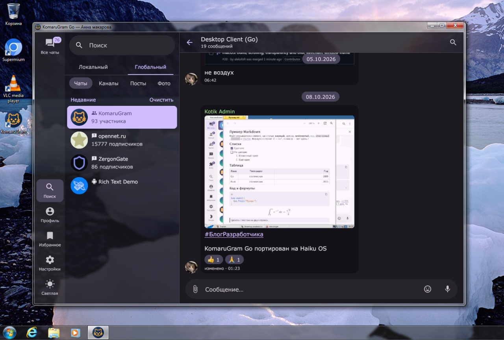

<div align="center">


# KomaruGram Go

Telegram Desktop client written from scratch in Go. Feature-rich and security-enhanced foundation. Easy to build and freely distributable, using a permissive license.

[English] | [Русский](README_RU.md) | [Other stuff](./docs/README_FULL.md) | [Widgets and UI](./docs/UI_COMPONENTS.md)


<p>Screenshot of KomaruGram Go, built and run on Windows 7</p>

</div>

## Why does this exist?

The official Telegram Desktop and its forks have many issues: heavy reliance on the C++ codebase and libraries ([TDLib](https://github.com/tdlib/td), Qt), a build process that is time-consuming and resource-intensive, and a high barrier to entry for developing your own modifications. In addition, it uses a copyleft license — our repository is completely free in terms of how you distribute it.

## What's inside?

Supports multi-account usage, hardware and software data encryption, local (offline) caching, animated stickers, emoji sets, in-chat GIF playback, voice message playback/recording, a media viewer, forums, Instant View, Markdown, Rich Messages, and Mini Apps.

WIP: message formatting and scheduled posting tools, chat and channel administration, user stories, gift sending, Telegram Stars, Gram Wallet, folder/cache/notification settings, a plugin system, hotkeys, and an editable interface layout.

[Gio](https://gioui.org/) handles the UI. It is a cross-platform, immediate-mode GUI library. It was chosen because it eliminates the typical limitations of frameworks, has no dependencies, doesn't break cross-platform builds, is fully compatible with Wayland, and can be ported to other platforms without any issues.

[gotd/td](https://github.com/gotd/td) implements MTProto and a little more, which serves as the foundation for all interactions with the Telegram protocol.

[wazero](https://github.com/wazero/wazero) is used as a high-performance WebAssembly sandbox for rendering stickers. It ensures cross-platform portability and guarantees code isolation without launching a separate process.

FFmpeg, mpv, VLC and Chromium/Firefox are available as external integrations that you must provide yourself. However, the application will work even without them, if the user is satisfied with that.

Without FFmpeg, or when chosen in the settings, GIFs and animated avatars play with FFmpeg's H.264 decoder compiled to WebAssembly. It is not built into the application: it is downloaded the first time it is needed from [libavcodec-wasm](https://github.com/komarugif/libavcodec-wasm), which holds its sources and build script. You can use your own build instead: see [Environment variables](#environment-variables).

Voice messages and music play in the application itself, with no FFmpeg or external player, as they download: Opus with libopus, MP3, FLAC and WAV with dr_libs, all compiled to WebAssembly and built in. AAC (M4A) plays with the Fraunhofer FDK AAC decoder, which is downloaded the first time it is needed from [fdk-aac-wasm](https://github.com/komarugif/fdk-aac-wasm), where its sources are; for your own build, see [Environment variables](#environment-variables).

## How to get started

Make a copy of this repository. Ensure that **[Go 1.27.1](https://go.dev/dl/)** is installed on your machine — it is the minimum required version. [Windows 7](./docs/BUILD_WINDOWS7.md) and [Haiku](./docs/BUILD_HAIKU.md) require their own patched versions of Go.

On Linux, Wayland and X11 development libraries may be required: `vulkan-headers mesa-egl mesa-dev libxkbcommon-dev wayland-dev`. Depending on your graphics environment, you can disable specific dependencies using build tags: `-tags nox11`, `-tags nowayland`, or `-tags novulkan`.

The build process may require up to 4.5 GB of RAM; please keep this in mind and close unnecessary applications during the initial build. If you run out of memory, use the environment variables `GOMAXPROCS=1 GOGC=50 GOMEMLIMIT=2GiB`. As a last resort, you can use the `-low-memory` flag with the `./cmd/*-build` scripts; this can cut memory usage during the build in half, at the cost of potential runtime performance loss. [Read more here](./docs/BUILD_LOW_MEMORY.md).

You can use this command to run the application across different platforms:
```
go run ./cmd/messenger
```

If you need to create an executable file, choose the command for your platform:
### **Linux/macOS**
```
go build -ldflags="-s -w" -o komarugram ./cmd/messenger
```
### **Linux** (AppImage with icon)
```
go run ./cmd/appimage-build -o KomaruGram.AppImage
```
### **Windows** (cross-compilation supported)
For your architecture:
```
go run ./cmd/windows-build -o komarugram.exe
```
To select a different architecture:
```
go run ./cmd/windows-build -arch arm64 -o komarugram.exe
```

### **Haiku**
```
go run ./cmd/haiku-build -o ~/apps/KomaruGram
```

## Environment variables

These variables replace a setting for one run, or name a file the application would otherwise download or look for itself.

| Variable | What it does |
|---|---|
| `KOMARUGRAM_PROXY` | An MTProxy link, `tg://proxy?server=…&port=…&secret=…`: the default of the `-proxy` flag. |
| `KOMARUGRAM_FONT`, `KOMARUGRAM_FONT_EXTRA`, `KOMARUGRAM_FONT_MONO`, `KOMARUGRAM_FONT_EMOJI` | A font file for the text, for the characters it lacks, for code and for emoji, over the fonts of the settings. |
| `KOMARUGRAM_EMOJI_SET` | The directory of an emoji pack to draw emoji with, over the one chosen in the settings. |
| `KOMARUGRAM_EMOJI_PACKS` | A catalog of emoji packs, a directory or an http(s) URL, for the settings to offer in place of the one built in. |
| `KOMARUGRAM_MASCOT` | A folder or a URL with `index.json` that the mascot's scenes in the About section are taken from, in place of [clawd-animations](https://github.com/komarugif/clawd-animations). |
| `KOMARUGRAM_AVCDEC` | Your own build of the H.264 decoder, in place of the one downloaded from [libavcodec-wasm](https://github.com/komarugif/libavcodec-wasm): the path to an `avcdec.wasm` file, or its URL. |
| `KOMARUGRAM_AACDEC` | Your own build of the AAC decoder, in place of the one downloaded from [fdk-aac-wasm](https://github.com/komarugif/fdk-aac-wasm): the path to an `aacdec.wasm` file, or its URL. Without an AAC decoder only M4A sound does not play. |
| `KOMARUGRAM_MINIAPP_BROWSER` | The browser Mini Apps, and the video player where it plays in a browser, run in: a program on `PATH`, the path to one, or the application id of a flatpak. It wins over the browser picked in the settings. |
| `KOMARUGRAM_TRAY_LIB`, `KOMARUGRAM_VOICE_LIB` | Haiku only: the path to `libtrayhaiku` and to `libvoicehaiku`, which are otherwise looked for beside the program and in `lib` beside it. |

The tests that need a real account or the machine's TPM are off unless asked for:

| Variable | What it does |
|---|---|
| `KOMARUGRAM_TEST_LIVE_HISTORY=1` | Checks the history of the account on this machine, only reading it. |
| `KOMARUGRAM_TEST_MEDIA_CHANNEL` | The title of the chat that check takes its media from. |
| `KOMARUGRAM_TEST_LIVE_EMOJI_SETS` | A directory the emoji packs of the catalog are installed into from Telegram, the way the settings do it, reading only. |
| `KOMARUGRAM_TEST_TPM=1` | Uses the machine's TPM. |

## Portability

KomaruGram Go can be ported to a wide range of operating systems thanks to its architecture and minimal dependencies. Check out [PLATFORMS.md](./docs/PLATFORMS.md) if you are interested in platform-specific details.

| Platform | Status |
|---|---|
| Windows 10/11 | ✅ First-class support |
| Windows 7 | ✅ Supported |
| Linux (Wayland) | ✅ First-class support |
| Linux (X11) | ✅ Supported |
| MacOS | ✅ First-class support |
| Haiku | ✅ Supported |
| FreeBSD | ⚠️ Should build; not tested in practice |
| OpenBSD | ⚠️ Should build in theory; not tested |
| NetBSD | ❓ Porting possible, with some caveats |
| Android | ❓ Porting possible, with some caveats |

## Vibecoding

The code in this project was primarily written by the GPT-6 Astra and Claude Opus 5.5 language models. The maintainer is responsible for the concept, selection of the technology stack and libraries, and quality control.

## Thanks

We thank the creator of [gotd/td](https://github.com/gotd/td) for the excellent library and [Gio](https://gioui.org/) for an architecture that is both simple and scalable for large applications. Branding is provided free of charge by the [t.me/komarugram](https://t.me/komarugram) project. Thanks augustwise and SvatoshGPT for providing the Claude Code and Codex subscriptions for the needs of this project.

## You Might Be Interested In

If you were looking for the KomaruGram that is a fork of Telegram Desktop, [click here](https://github.com/svatoshgpt/komarugram). Our project has similar goals, but it was written from scratch in Go and is not a fork of Telegram Desktop

## License

When working with this project, you have no licensing obligations regarding the modification or distribution of the code. Some dependencies require that you respect copyright, but they do not impose any restrictions on the code itself (permissive MIT-compatible licenses).

There are two exceptions, both kept out of this repository and out of the binary, loaded at run time, and easy to replace or leave out:

- The H.264 decoder is FFmpeg's, licensed under the LGPL 2.1 or later. It is in [libavcodec-wasm](https://github.com/komarugif/libavcodec-wasm).
- The AAC decoder is the Fraunhofer FDK AAC Codec Library, under Fraunhofer's own license: free to copy and distribute, with its source, but granting no patent rights. AAC is covered by patents licensed through [Via LA](https://www.via-la.com): using the decoder may need such a license, in particular for commercial use. Debian counts it as non-free for this reason. It is in [fdk-aac-wasm](https://github.com/komarugif/fdk-aac-wasm).

The licenses of the third-party code and files the client contains or downloads are listed in [docs/THIRD_PARTY_LICENSES.md](docs/THIRD_PARTY_LICENSES.md).
